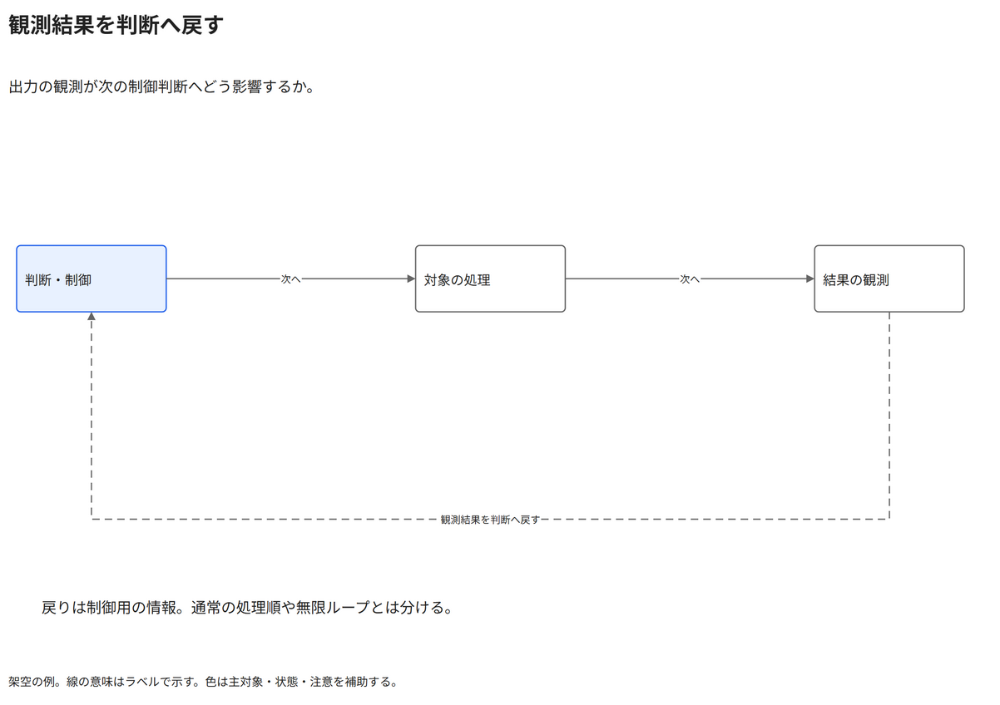

# 観測結果を判断へ戻す

出力の観測が次の制御判断へどう影響するか。

[Draw.io](example.drawio) · [SVG](preview.svg) · [情報と採否](metadata.yaml) · [IR](diagram-ir.json)

採用条件: 出力の観測が次の制御判断へどう影響するかを説明したい場合。

不向きな条件: 入力に示されていない条件・順序・数量を補う場合。

参照: SRC-017（[URL一覧](../../sources/urls.md)）。関係の種類と粒度を抽出し、固有データと具体的配置をコピーせず架空の予約サービスへ適応した。

図形・表・所属・接続・ラベルをDraw.ioで編集できる。

点検記録: 主処理を実線で左から右へ、観測結果の戻りを下側の破線矢印で区別。戻り線の矢尻を追加し、制御先を明確にした。文字を囲う空白が十分。
