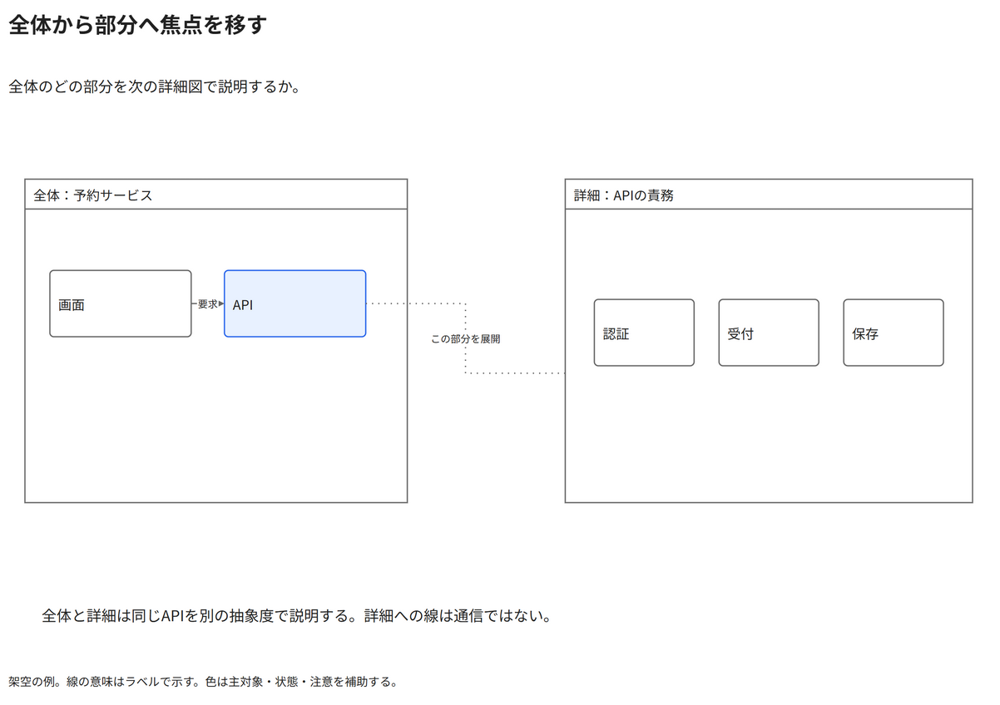

# 全体から部分へ焦点を移す

全体のどの部分を次の詳細図で説明するか。

[Draw.io](example.drawio) · [SVG](preview.svg) · [情報と採否](metadata.yaml) · [IR](diagram-ir.json)

採用条件: 全体のどの部分を次の詳細図で説明するかを説明したい場合。

不向きな条件: 入力に示されていない条件・順序・数量を補う場合。

参照: SRC-010, SRC-045（[URL一覧](../../sources/urls.md)）。関係の種類と粒度を抽出し、固有データと具体的配置をコピーせず架空の予約サービスへ適応した。

図形・表・所属・接続・ラベルをDraw.ioで編集できる。

点検記録: 全体図のAPIを強調し、詳細の責務へ点線で対応付ける。通信の実線と詳細展開を区別し、左右の枠をまたぐ線とラベルが見える。
