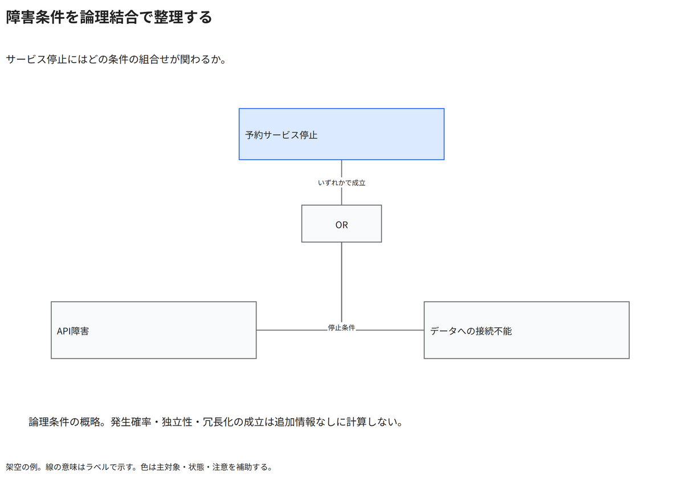

# 障害条件を論理結合で整理する

サービス停止にはどの条件の組合せが関わるか。

[Draw.io](example.drawio) · [SVG](preview.svg) · [情報と採否](metadata.yaml) · [IR](diagram-ir.json)

採用条件: サービス停止にはどの条件の組合せが関わるかを説明したい場合。

不向きな条件: 入力に示されていない条件・順序・数量を補う場合、論理結合の意味が不明なまま故障確率を算出したい場合。

参照: SRC-034（[URL一覧](../../sources/urls.md)）。関係の種類と粒度を抽出し、固有データと具体的配置をコピーせず架空の予約サービスへ適応した。

図形・表・所属・接続・ラベルをDraw.ioで編集できる。

点検記録: 上位停止条件と二つの下位条件をORで結合している。線の合流はORの共通入力であり、ラベルが重ならない。確率・独立性の未検証を明記。
