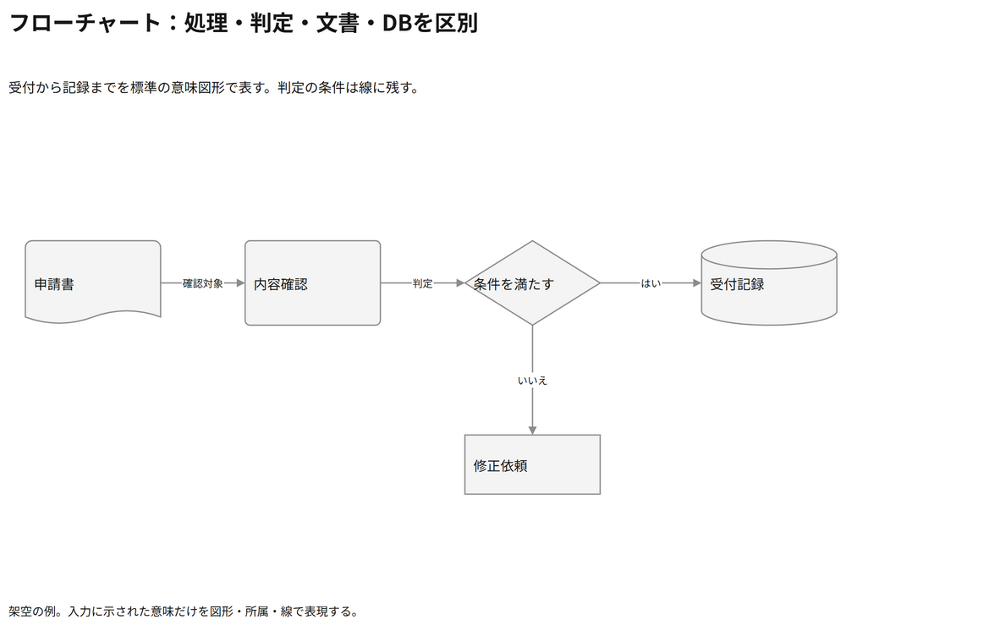
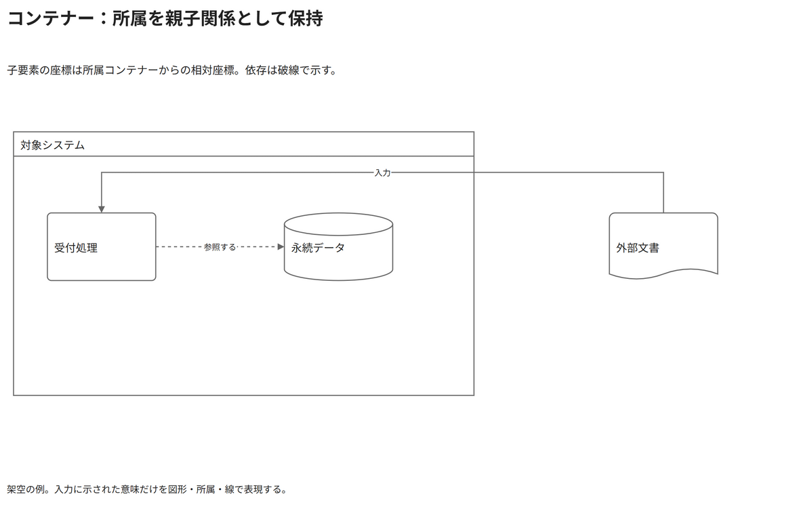
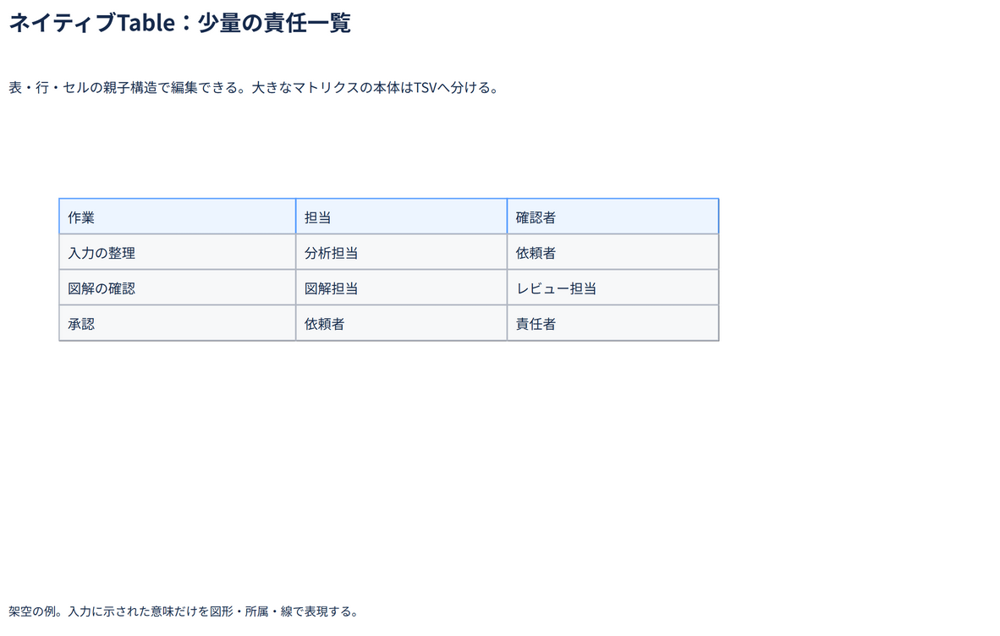
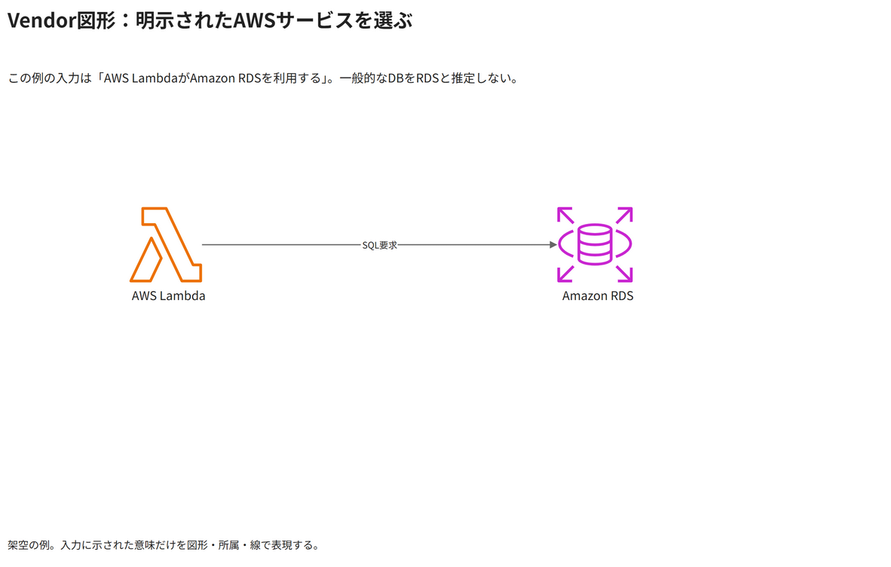
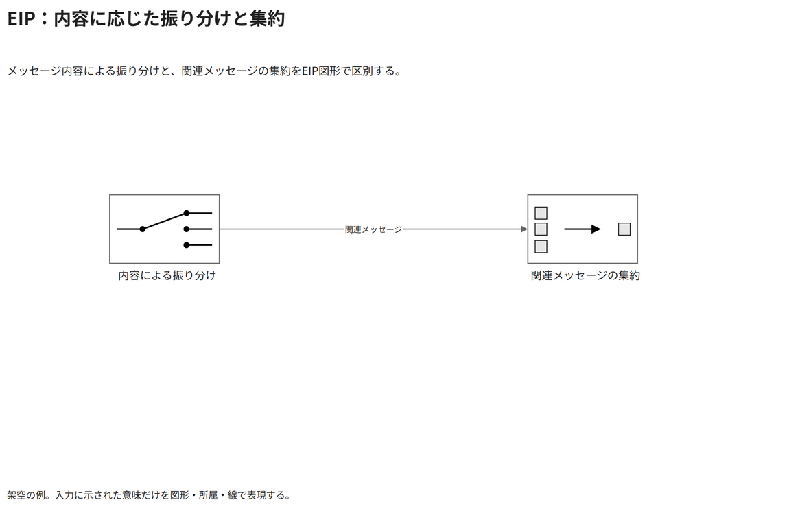
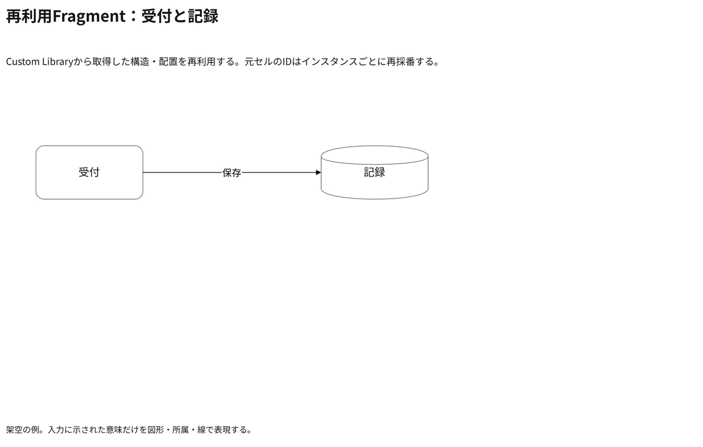
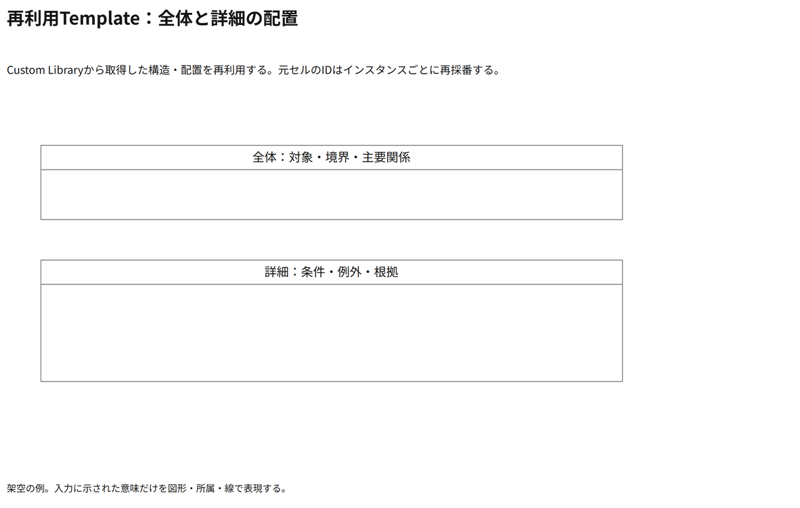

# Draw.ioネイティブ機能のサンプル

[7ページのDraw.io](10-native-capabilities.drawio)。ページタブで切り替える。全て架空の例。

## フローチャート：処理・判定・文書・DBを区別

受付から記録までを標準の意味図形で表す。判定の条件は線に残す。

テーマ: T01。IR: [入力](sources/native-flow-ir.json)／[解決済み](sources/native-flow-resolved.json)。

## コンテナー：所属を親子関係として保持

子要素の座標は所属コンテナーからの相対座標。依存は破線で示す。

テーマ: T02。IR: [入力](sources/native-membership-ir.json)／[解決済み](sources/native-membership-resolved.json)。

## ネイティブTable：少量の責任一覧

表・行・セルの親子構造で編集できる。大きなマトリクスの本体はTSVへ分ける。

テーマ: T03。IR: [入力](sources/native-table-ir.json)／[解決済み](sources/native-table-resolved.json)。

## Vendor図形：明示されたAWSサービスを選ぶ

この例の入力は「AWS LambdaがAmazon RDSを利用する」。一般的なDBをRDSと推定しない。

テーマ: T05。IR: [入力](sources/native-aws-ir.json)／[解決済み](sources/native-aws-resolved.json)。

## EIP：内容に応じた振り分けと集約

メッセージ内容による振り分けと、関連メッセージの集約をEIP図形で区別する。

テーマ: T02。IR: [入力](sources/native-eip-ir.json)／[解決済み](sources/native-eip-resolved.json)。

## 再利用Fragment：受付と記録

Custom Libraryから取得した構造・配置を再利用する。元セルのIDはインスタンスごとに再採番する。

テーマ: T01。IR: [入力](sources/native-fragment-ir.json)／[解決済み](sources/native-fragment-resolved.json)。

## 再利用Template：全体と詳細の配置

Custom Libraryから取得した構造・配置を再利用する。元セルのIDはインスタンスごとに再採番する。

テーマ: T01。IR: [入力](sources/native-template-ir.json)／[解決済み](sources/native-template-resolved.json)。

